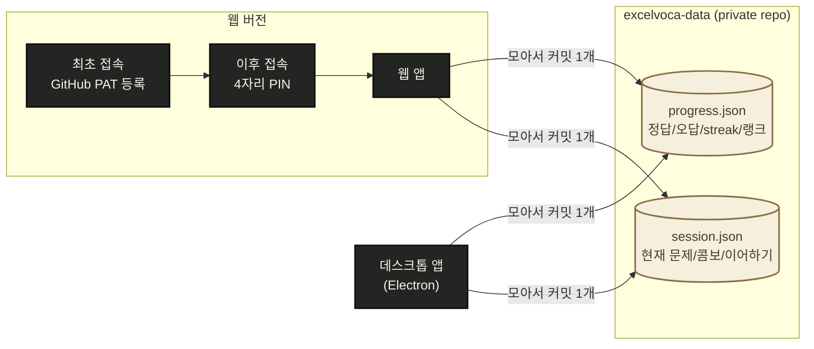
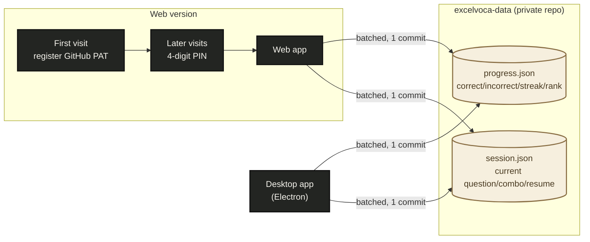

# ExcelVoca

[](https://github.com/ditto-404/excelvoca-web/actions)
[](https://ditto-404.github.io/excelvoca-web/)
[](#구성)
[](#excelvoca)
[](#english)

겉보기엔 엑셀, 실제로는 TEPS 어휘 퀴즈. `Tab` 한 번이면 화면 전체가 가짜 업무 대시보드(Boss Mode)로 바뀌고, 다시 `Tab`을 누르면 풀던 문제·콤보·통계 그대로 돌아옵니다. (Boss Mode는 데스크톱 앱 전용이며, 웹 버전에는 애초에 위장할 스프레드시트 화면이 없어 해당 기능이 없습니다.)

## 구성

- **데스크톱 앱** (`src/`): Plain Electron + vanilla ES6+ (React/번들러/TypeScript 없음). `contextIsolation`/`sandbox` 켠 표준 Electron 보안 구성.
- **웹 버전** (`web/`): 같은 게임 로직(`src/game`, `src/storage`, `src/data`)을 그대로 재사용하는 경량 브라우저 프론트엔드. 폰이나 Electron을 설치할 수 없는 PC에서 이어서 학습할 때 사용.
- **단어 데이터** (`data/teps_words.csv`): 직접 큐레이션한 TEPS 어휘 목록. 뜻/예문/예문 번역 외에 유명한 연어(collocation) 힌트와 비슷한 뜻의 동의어 힌트도 일부 단어에 붙어 있습니다.

## 게임 모드

데스크톱(리본 메뉴)과 웹(상단 모드 전환 버튼) 양쪽에서 동일하게 4가지 모드를 오갈 수 있습니다. 정답/오답/streak 등 학습 기록은 같은 단어 항목이면 모드와 무관하게 공유됩니다.

- 🔤 **클래식**: 단어를 보고 4지선다로 뜻 고르기 (약 30% 확률로 뜻→단어 역방향 출제). 유일하게 이어하기(세션 복원)를 지원하는 모드입니다.
- 📖 **예문**: 영어 예문을 먼저 읽고(스스로 페이스 조절), 준비되면 4지선다로 뜻을 고릅니다.
- ⌨️ **타이핑**: 한국어 뜻을 보고 영어 단어를 직접 입력 (객관식이 아닌 능동 회상 방식).
- 🔗 **매칭**: 영어 목록과 한국어 뜻 목록을 각각 클릭해서 짝짓기.

## 랭크와 난이도

정답을 10연속으로 맞히면 그 단어를 "마스터"한 것으로 치고, 마스터한 단어 수(쉬운 단어보다 어려운 단어를 더 높게 쳐줌)에 따라 Intern → Junior Analyst → Analyst → Senior Analyst → Manager → Director → Executive → CEO까지 8단계 직급으로 승진합니다.

단어마다 1~5단계 난이도도 매겨져 있는데, 랭크가 낮을수록 쉬운 단어가 압도적으로 많이 나오다가 랭크가 오를수록 점점 어려운 단어 비중이 커집니다.

| 랭크 | 레벨1 | 레벨2 | 레벨3 | 레벨4 | 레벨5 |
| --- | --- | --- | --- | --- | --- |
| Intern | 70% | 18% | 8% | 3% | 1% |
| Junior Analyst | 55% | 25% | 13% | 5% | 2% |
| Analyst | 35% | 30% | 20% | 10% | 5% |
| Senior Analyst | 22% | 28% | 27% | 15% | 8% |
| Manager | 12% | 20% | 30% | 23% | 15% |
| Director | 7% | 14% | 27% | 28% | 24% |
| Executive | 4% | 9% | 20% | 32% | 35% |
| CEO | 2% | 5% | 13% | 30% | 50% |

## 실행

### 데스크톱 (Electron)

```bash
npm install
npm start
```

### 웹 버전

`web/index.html`을 정적 호스팅(GitHub Pages 등)하면 됩니다. 최초 접속 시 진행 상황 동기화용 GitHub Personal Access Token을 한 번 등록하면, 그다음부터는 4자리 PIN만으로 열 수 있습니다 (아래 참고). 화면 안의 "기록 관리" 버튼으로 오늘 통계만 초기화하거나 전체 학습 기록을 리셋할 수도 있습니다.

## 진행 상황 동기화

두 프론트엔드가 동일한 학습 기록을 공유하도록, `progress.json`/`session.json`은 이 저장소가 아니라 **별도의 private 저장소**에서 읽고 씁니다. 이 저장소에는 개인 학습 데이터가 전혀 포함되지 않습니다.

읽기는 Contents API를 그대로 쓰지만, **쓰기는 모아서 한 커밋으로** 보냅니다. Contents API는 PUT 한 번이 커밋 한 개인데 문제를 풀 때마다 `progress.json`과 `session.json`이 함께 저장되므로, 그대로 두면 한 문제당 커밋이 두 개씩 쌓입니다. 그래서 저장은 즉시 로컬(데스크톱은 파일, 웹은 localStorage)에만 반영하고, 30초 동안 저장이 멎거나 최대 5분이 지나거나 앱을 닫을 때 Git Data API로 **변경된 파일 전체를 커밋 하나**로 올립니다. 전송에 실패해도 로컬 사본은 이미 안전하며 다음 시도에 재전송됩니다.



## 라이선스

개인용 프로젝트입니다. 재사용/배포를 염두에 두고 만들지 않았습니다.

---

<a id="english"></a>

## English

[](#excelvoca)
[](#english)

Looks like Excel, is actually a TEPS vocabulary quiz. Press `Tab` once and the whole screen flips into a fake work dashboard (Boss Mode); press `Tab` again and you're back exactly where you left off, with the same question, combo, and stats. (Boss Mode is desktop-app only; the web version has no spreadsheet screen to disguise itself as, so it doesn't include this feature.)

### Structure

- **Desktop app** (`src/`): Plain Electron + vanilla ES6+ (no React/bundler/TypeScript). Standard Electron security setup with `contextIsolation`/`sandbox` enabled.
- **Web version** (`web/`): A lightweight browser frontend that reuses the same game logic (`src/game`, `src/storage`, `src/data`). Useful for continuing study on a PC where you can't install a phone app or Electron.
- **Word data** (`data/teps_words.csv`): A hand-curated TEPS vocabulary list. Besides meaning/example sentence/translated example, some entries also include well-known collocation hints and synonym hints.

### Game modes

Both the desktop app (ribbon menu) and the web version (mode switch button at the top) offer the same 4 modes. Correct/incorrect/streak and other learning records are shared across modes for the same word entry.

- 🔤 **Classic**: See the word, pick the meaning from 4 choices (about 30% of the time it's reversed, meaning to word). The only mode that supports resuming a session.
- 📖 **Example**: Read an English example sentence first (at your own pace), then pick the meaning from 4 choices when ready.
- ⌨️ **Typing**: See the Korean meaning and type the English word yourself (active recall instead of multiple choice).
- 🔗 **Matching**: Click through an English list and a Korean-meaning list to pair them up.

### Rank and difficulty

Answer a word correctly 10 times in a row and it's considered "mastered." Based on the number of mastered words (harder words count for more than easy ones), you're promoted through 8 ranks: Intern → Junior Analyst → Analyst → Senior Analyst → Manager → Director → Executive → CEO.

Each word also has a difficulty level from 1–5. At lower ranks, easy words dominate; as your rank climbs, harder words show up more often.

| Rank | Level 1 | Level 2 | Level 3 | Level 4 | Level 5 |
| --- | --- | --- | --- | --- | --- |
| Intern | 70% | 18% | 8% | 3% | 1% |
| Junior Analyst | 55% | 25% | 13% | 5% | 2% |
| Analyst | 35% | 30% | 20% | 10% | 5% |
| Senior Analyst | 22% | 28% | 27% | 15% | 8% |
| Manager | 12% | 20% | 30% | 23% | 15% |
| Director | 7% | 14% | 27% | 28% | 24% |
| Executive | 4% | 9% | 20% | 32% | 35% |
| CEO | 2% | 5% | 13% | 30% | 50% |

### Running it

#### Desktop (Electron)

```bash
npm install
npm start
```

#### Web version

Serve `web/index.html` as a static site (e.g. GitHub Pages). On first visit you register a GitHub Personal Access Token once for progress sync; after that, a 4-digit PIN is enough to open it (see below). The in-app "Manage records" button lets you reset just today's stats or your entire learning history.

### Progress sync

So both frontends share the same learning record, `progress.json`/`session.json` are read and written from a **separate private repository**, not this one. This repository contains no personal learning data.

Reads still go through the Contents API, but **writes are batched into a single commit**. One Contents-API PUT is one commit, and every answered question saves both `progress.json` and `session.json` — which would cost two commits per question. So a save only touches local storage (a file on desktop, `localStorage` on web) right away, and the changed files are pushed together as **one Git Data API commit** once saving pauses for 30 seconds, five minutes elapse, or the app closes. A failed push keeps the local copy and retries on the next flush.



### License

Personal project. Not built with reuse or distribution in mind.
